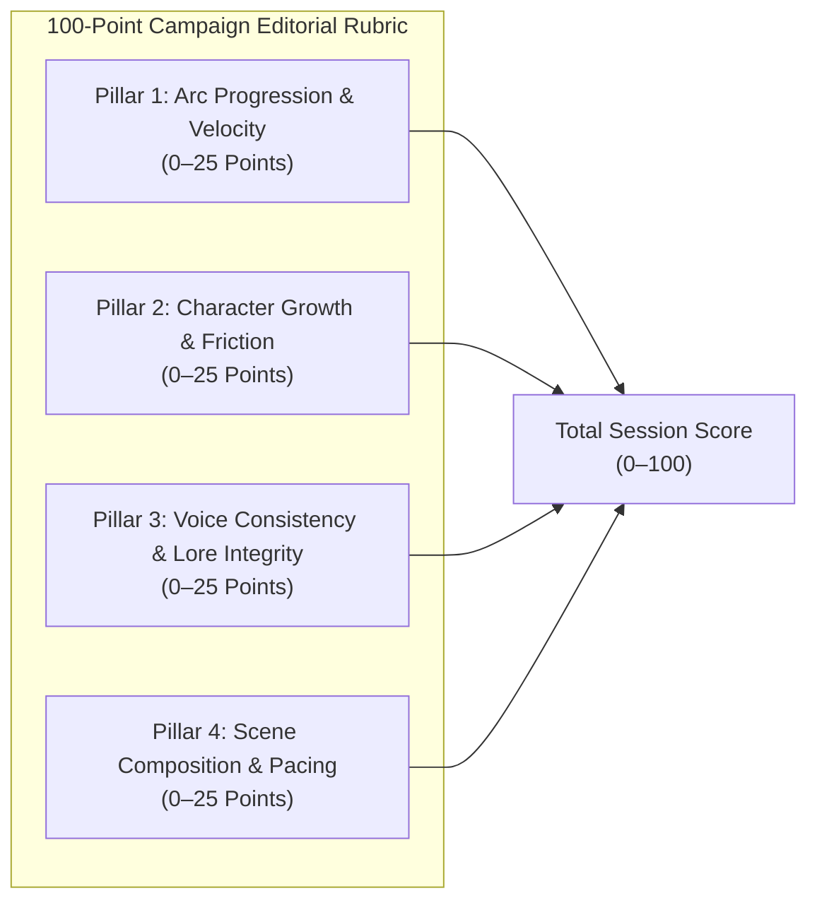

# 🛡️ D&D Project Pipeline Audit, Learnings & Rubric Overhaul

**Audit Reference:** PIPELINE-AUDIT-2026-11-01  
**Scope:** `dnd-scribe` (Upstream Engine & Canon) $\leftrightarrow$ `dndwikis` (Downstream Host & Interactive Readers)  
**Status:** ACTIVE STANDARD (Codified in `.agents/skills/dnd-dual-repo-governor/SKILL.md`)  

---

## 1. Executive Synthesis & Architectural Root-Cause Retrospective

Recent session publishing cycles suffered from severe regressions where introducing new features (such as the Campaign Codex) inadvertently broke established readers, bypassed verification linters, and degraded the literary quality of the narrative.

In accordance with our engineering invariants, any modification to how we create, test, and score ebooks must explicitly link back to our prior postmortems and attempts (`POSTMORTEM_SESSION_8_DEPLOYMENT_BREACH.md`, `MULTI_STEP_UX_AUDIT_REPORT.md`, `OVERNIGHT_AUDIT_PLAN.md`).

### The 5 Systemic Failure Modes & Root-Cause Analysis

| Incident ID | Failure Mode | Root Cause | Impact | Permanent Pipeline Gate |
| :--- | :--- | :--- | :--- | :--- |
| **FAIL-01** | **Session Omission Across Hubs** | No cross-repo check asserted that manifests discovered upstream are represented in downstream reader files and hub navigation. | Session 8 was published in the Codex but was completely omitted from `index.html`, `uneraseable-s8.html`, and `threads.html`. | **Gate 4 (Zero-Omission Invariant):** Dynamically audits all upstream manifests; blocks deployment if any session is missing from `index.html`, `codex.html`, `critics.html`, or `threads.html`. |
| **FAIL-02** | **Bot Token Authentication Outage** | `build_ebooks.py` relied on Windows paths (`d:/Code/...`) and Python `cryptography` to extract the GitHub App private key. On macOS/Linux, it silently evaluated `BOT_PKCS8_B64 = ""`. | Readers attempting to submit review PRs received `❌ Submission error: Bot authentication credentials missing.`. | **Gate 3 (Bot Auth Health):** Validates that `BOT_APP_ID`, `BOT_INSTALLATION_ID`, and base64 PKCS#8 keys exist and are decodable (>1,000 chars) in all compiled readers and `codex-wiki.html`. |
| **FAIL-03** | **Scope Creep: Wiki Hyperlinks in Story Prose** | `GLOBAL_ENTITY_AUTOLINKER` (designed for the internal wiki) was hooked into `ch_novel_blocks_html` in `build_ebooks.py`, turning character and place names into underlined amber hyperlinks. | Over 420 words across Sessions 1–8 were converted into distracting web links, destroying novel immersion and creating container noise. | **Gate 2 (Zero-Hyperlink Prose Invariant):** Inspects `
` across all readers; strictly asserts that `<a>` tags and entity links count equals **EXACTLY 0**. |
| **FAIL-04** | **Meta GM Dialogue Bleed** | LLM synthesis mistook raw GM turn markers (`Luke Foreman:`) for story dialogue, inserting out-of-character lines (*"Luke Foreman's voice resonated from the head of the long table, the Game Master leaning forward..."*). | Boke the fourth wall in clean Track B novel prose. | **Gate 1 (Anti-Meta Bleed Audit):** Scans clean story markdown and manifest blocks with adversarial regex filters against GM table terms; blocks deployment if detected. |
| **FAIL-05** | **Self-Aggrandizing Grade Inflation & Container Clutter** | Evaluation engine defaulted to ungrounded straight-A grades (`A+`, `A-`) and trivial meta-table footnotes ("Foundry hosting delays"), while the UI accumulated nested boxes and badges. | Useless editorial critiques; self-congratulatory scoring; visually noisy, container-heavy reader cards. | **The 4-Pillar 100-Point Numerical Rubric** & **Streamlined Flat-Card UI Architecture** (detailed below). |

---

## 2. The 4-Pillar Numerical Grading Rubric (100-Point Scale)

To eradicate the "straight-A self-aggrandizing trap", letter grades (`A+`, `A`, `B`) are permanently abolished in favor of a rigorous, grounded **100-point numerical rubric**. Sessions and characters are evaluated **in the context of preceding chapters, long-term arc momentum, and character consistency**.

### Pillar Definitions

1. **Pillar 1: Arc Progression & Narrative Velocity (0–25 Points)**
   - *Core Question:* Did this session meaningfully advance active campaign threads and escalate stakes from the previous chapter, or did it spin its wheels in transitional stall?
   - *Deductions:* Circular debates, lingering in planning rooms without execution, unearned cliffhangers.
2. **Pillar 2: Character Growth & Inter-Party Friction (0–25 Points)**
   - *Core Question:* Did the characters confront their flaws, reveal vulnerability, or test interpersonal boundaries?
   - *Deductions:* Passenger-seat complacency (characters sitting silently while one person acts), repeating static catchphrases, lack of consequence.
3. **Pillar 3: Voice Consistency & Roleplay Integrity (0–25 Points)**
   - *Core Question:* Is dialogue authentic to established cadence, cultural vernacular, and historical backstories without unanchored retcons?
   - *Deductions:* Modern meta colloquialisms in historical speech, out-of-character sudden competencies without table precedent.
4. **Pillar 4: Scene Composition & Addictive Pacing (0–25 Points)**
   - *Core Question:* Are scenes blocked with tactile sensory grounding, kinetic combat, and compelling dramatic transitions that demand reading the next chapter?
   - *Deductions:* White-room syndrome, clunky spatial blocking, abrupt unearned scene transitions.

### Score Tier Standards
- **90–100 (Instant Classic / Masterclass):** Rare, high-stakes milestone where major character arcs collide and campaign trajectory shifts irreversibly.
- **80–89 (High-Engagement Chapter):** Strong narrative drive, memorable character set pieces, and authentic friction with only minor pacing drag.
- **70–79 (Functional Transitional Chapter):** Necessary connective tissue; advances the mission but suffers from logistical stalls, asymmetric spotlight, or muted personal stakes.
- **60–69 (Underperforming / Stalled):** Heavy table drag, circular decision-making, and minimal character progression.
- **<60 (Critical Narrative Failure):** Structural breakdown, unresolved lore contradictions, or severe fourth-wall bleed.

---

## 3. Grounded Re-Evaluation: Session 8 Audit & Character Report Cards

Applying this rubric to Session 8 (*The Capital Incursion & The Evidence Locker Heist*):

### Overall Session Scores
- **Tomatometer (Literary Craft & Pacing):** **`74 / 100`** *(Solid Transitional Chapter)*
  - *Breakdown:* Arc Progression: `18/25` · Character Growth: `19/25` · Voice Consistency: `20/25` · Scene Composition: `17/25`.
  - *Verdict:* A functional transitional heist featuring brilliant tactical moments (the Lost Creek Wonka defense and the Meld into Stone evidence brick), pulled down by protracted blueprint debates and asymmetric party engagement in Act I.
- **Popcornmeter (Audience Entertainment Score):** **`82 / 100`**
  - High entertainment payoff from the Sharpie boot homage, Wonka combat javelins, and the PIG brick distraction, tempered by a slow start.

### Character-by-Character Performance Breakdown (Contextual Growth & Friction)

| Character | Player | Score | Campaign Growth & Tactical Impact | Critical Shortcomings (Narrative Friction) | Next Session Coaching Directive |
| :--- | :--- | :---: | :--- | :--- | :--- |
| **Prof. Edward Dravin** | William Webb | **`84 / 100`** | Continues his compelling trajectory from a sheltered academic into a pragmatic criminal mastermind. Inscribing legal provenance onto Alfie's shoe was a brilliant fusion of academic pedantry and tactical cunning. | Over-intellectualized blueprint discrepancies in the storm drain, burning critical operational time debating canted angles rather than moving with urgency. | Trust operational execution once deployed; avoid second-guessing architectural anomalies under live pressure. |
| **Alfie** | Sophie Foreman Noone | **`82 / 100`** | Committed fully to a high-risk infiltration strategy, enduring physical labeling and being smuggled into evidence custody inside a stone brick. Demonstrated deep, unstated loyalty to the crew. | Narrative presence was restricted by the inanimate brick transport; her signature verbal wit and dialogue friction were absent during the middle act. | Re-establish vocal dominance once inside the evidence locker; take charge of interrogating whatever temporal anomalies are uncovered. |
| **Pierre** | Luke S | **`79 / 100`** | The Wonka javelin recital on Lost Creek was an iconic character beat showcasing Pierre's flamboyant defense mechanism against terror. Posing as a Make-A-Wish representative revealed growing comfort with deceit. | Yielded strategic leadership entirely to Dravin; his aristocratic French aloofness occasionally detaches him from the emotional urgency of the mission. | Assert Pierre's personal stake in the Loom fragments; avoid settling into a passive support role during high-stakes urban infiltrations. |
| **Game Master** | Luke Foreman | **`76 / 100`** | Successfully ratcheted up tension by introducing ticking operational countdowns and the impending threat of the historical relic hunter, shifting the tone into urban fantasy noir. | Blueprint ambiguities created circular table confusion early on, bogging down Act I in compass debates before play found its rhythm. | Keep tactical briefings concise and unambiguous so player momentum carries smoothly from planning into execution. |
| **Eusacles** | John Hagey | **`73 / 100`** | A transitional chapter. Auditing his Paladin gear and finally donning heavy armor with Theodore's blessing addressed long-standing mechanical neglect. | Passenger-seat syndrome: remained completely passive during the heist planning and municipal entry, offering little resistance or tactical input. | Step into an active moral and physical leadership role; bring demigod friction to the table rather than quietly deferring to the mortals. |

*Notice:* Worthless meta-logistical notes ("Foundry hosting delays") have been permanently excised. Every critique now directly assesses the character's contribution to narrative momentum, agency, and growth.

---

## 4. UI De-Noising & Modern Flat Card Architecture

To resolve the container-heavy, noisy visual presentation:

1. **Eliminated Box-in-a-Box Nesting:** Replaced the triple-nested dark boxes with a single, sleek surface (`bg-slate-900/90 border border-slate-800`).
2. **Removed Overlapping Badges:** Eliminated the redundant `Rotten Tomatoes Post-Mortem` + `Story Review` + `Acquisitions Editor Audit` tag collision in favor of a clean, single eyebrow: `EDITORIAL AUDIT · SESSION {N}`.
3. **Flat Numerical Score Header:** Clear, minimal score pills (`Critic: 74/100 · Audience: 82/100`) without oversized icon boxes.
4. **Streamlined Participant Row:** Single horizontal row displaying character icon, short name, and bold numerical score (`Dravin: 84`, `Alfie: 82`, `Pierre: 79`, `GM: 76`, `Eusacles: 73`). No letter grades.
5. **Typographic Blockquote:** Editorial summary rendered with an elegant left border accent (`border-l-2 border-rose-500/80`) rather than trapped inside an extra bordered container.
6. **Unified Action CTA:** A single, clean link button (`Read Full Character Breakdown & Rubric →`) without redundant secondary prompts or native browser tooltips.
